  

  
  
  

## What I build

| | |
|---|---|
| **App development** | Cross-platform mobile apps and installable web apps |
| **Custom software** | Business tools, dashboards and management systems built around how a team works |
| **Backend & cloud** | Scalable, low-cost serverless architecture on AWS |
| **Performance** | Fast, reliable software even on poor networks |
| **AI integration** | LLM-powered features and chatbots in real products |

## Stack

  

## GitHub activity

